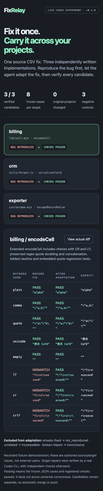

# FixRelay

**Fix a copied bug once. Carry the fix into your other projects—with evidence.**

FixRelay is an experimental local CLI for JS/TS utilities. Give it a source fix
commit and a finite JSON regression/control witness. It ranks exported functions
across your repositories, runs the witness in separate worktrees, and prepares
adaptation candidates only where the regression is reproduced. Your agent writes
the equivalent fix. FixRelay repeats the witness, runs registered checks and
records the before/after evidence without merging into your originals.

This is a separate project. It is not a universal semantic code search engine,
automatic repair model or hosted GitHub bot. v0.1.0 supports exported top-level
JS/TS functions with the **same JSON input/output interface**. Different names and
implementation bodies are supported; automatic API/signature adaptation is not.

## Why not just send the same patch everywhere?

A copied utility may have a different name, syntax or implementation. A text patch
may not apply, and similar-looking code might already be fixed or do something
else. FixRelay separates three decisions: structural ranking, behavioral
reproduction, and agent adaptation. A compile/import/runtime error is inconclusive,
not proof that the same bug exists. [Related work](docs/architecture.md) describes
existing cross-repository porting and semantic clone tools; novelty is not claimed.

## Install from source

Node.js 22.12+ and Git are required. The only runtime dependency is TypeScript's
parser, pinned to 6.0.3.

```sh
git clone https://github.com/light338/fixrelay.git
cd fixrelay
npm install
npm test
node bin/fixrelay.mjs help
```

For the committed lockfile, use `pnpm install --frozen-lockfile`. There is no npm
registry publication; an unrelated registry package with this name is not this CLI.

## One fix, three implementations

The live example has a source CSV fix for embedded CR/LF fields, three independently
written buggy JS/TS variants, and three controls: already fixed, incompatible and
broken import. It supplies **no target repair implementations**. A real Codex CLI
adapts each candidate, and the runner independently checks all results afterward.
The fixture's source bug/fix, target starting code and expected cases are authored
inputs. This is not evidence of external adoption or arbitrary bug-fixing ability.

```sh
FIXRELAY_CODEX_BIN=/absolute/codex node examples/live.mjs /absolute/new-demo-directory
```

This opt-in run needs an authenticated Codex CLI and consumes your existing account
capacity. Default sandbox is `workspace-write`; original global MCP configuration
is not changed. `FIXRELAY_CODEX_SANDBOX` can select a supported CLI sandbox mode.
The desktop executor used in the recorded run cannot nest its macOS sandbox;
`danger-full-access` was used only within that executor's enforced outer filesystem
sandbox. Keep the default in an ordinary terminal. [Execution boundaries](docs/architecture.md)
explain why a worktree is not an OS sandbox.

A successful run produces `evidence/report.json`, `evidence/review.md`, candidate
diffs and local raw agent logs. To view that actual report interactively:

```sh
node examples/report-html.mjs /absolute/demo/evidence/report.json /absolute/report.html
```

Open the generated self-contained HTML in a browser. It contains source code and
project evidence; review it before sharing publicly. No network requests are made
by the viewer. [Recorded validation](docs/validation.md) states the tested scope.



## Use your own repositories

Start with small clean repositories containing committed initial states. Prepare
a JSON request outside the source/targets:

```json
{
  "source": "/absolute/project-with-fix",
  "before": "FIX_COMMIT^",
  "after": "FIX_COMMIT",
  "entry": "src/csv.mjs",
  "exportName": "csvCell",
  "instruction": "Quote embedded line breaks while preserving existing CSV behavior",
  "cases": [
    {"id":"plain","kind":"control","args":["alpha"],"expected":"alpha"},
    {"id":"newline","kind":"regression","args":["a\nb"],"expected":"\"a\nb\""}
  ]
}
```

Then:

```sh
node bin/fixrelay.mjs capture --state /absolute/new-run --input fix.json
node bin/fixrelay.mjs scan --state /absolute/new-run --json '{"repos":["/absolute/app-a","/absolute/app-b"]}'
node bin/fixrelay.mjs probe --state /absolute/new-run --json '{"repo":"/absolute/app-a","file":"lib/cell.mjs","exportName":"encodeCell"}'
node bin/fixrelay.mjs prepare --state /absolute/new-run --json '{"probeId":"PROBE_ID","checks":[["node","--test"]]}'
node bin/fixrelay.mjs prompt --state /absolute/new-run --json '{"planId":"PLAN_ID"}'
```

The state directory must be new and separate from all originals. Capture resolves
both commits and requires the controls to pass before the source fix, at least one
regression to fail before, and every registered case to pass after. Each probe is
repeated; observed instability is inconclusive. Two repetitions cannot prove
absence of flakiness.

Review the ranked candidates, then probe their actual interfaces. A source/target
API mismatch needs an independently reviewed witness mapping before automation;
this version will not invent a mapping or rewrite the oracle to force a result.

To scan/probe a list and automatically prepare only reproduced targets, create
`repos.json` with `{"targets":[{"repo":"/absolute/app-a","checks":[["node","--test"]]},{"repo":"/absolute/app-b","checks":[["node","--test"]]}],"limit":20}` and run:

```sh
node bin/fixrelay-discover.mjs --state /absolute/new-run --input repos.json
```

This executes the witness, so use trusted repositories. `limit` bounds executed
probes (1–64); `minScore` optionally filters ranking hints. Unprobed functions are
not cleared of bugs. Omit a target's `checks` to probe without creating a plan.

`prepare` requires a reproduced probe and checks that already pass before adapting.
Give the returned brief to your coding agent or implement the candidate yourself.
Keep existing tracked tests, package configuration, pinned witness and registered
external contracts unchanged. After editing:

```sh
node bin/fixrelay.mjs finish --state /absolute/new-run --json '{"planId":"PLAN_ID","note":"Describe the target-specific adaptation"}'
node bin/fixrelay.mjs report --state /absolute/new-run --json '{"planId":"PLAN_ID","format":"markdown"}' > /outside/projects/review.md
```

`report` without `planId` lists probes and all prepared candidates. `finish` returns
exit 1 for failed checks; invalid input/integrity errors return 2. The core does not
invoke a model, push commits, create PRs, deploy or automatically accept changes.
Only the explicitly invoked live example launches Codex.

## Verdicts and limits

| Probe verdict | Meaning |
|---|---|
| `reproduced` | Controls pass and at least one registered regression mismatches |
| `not_reproduced` | Every registered case passes; not proof the function is universally bug-free |
| `incompatible` | A control case mismatches; do not assume this is the same function/bug |
| `inconclusive` | Import/runtime error, inconsistent repetition or probe-side file changes |

Passing candidate checks mean the frozen finite witness and registered commands
passed. Later edits make verification stale. Reports retain original/target diffs,
notes and source provenance. A source root LICENSE is copied when available; this
is not a complete license compatibility or notice analysis.

Exported functions must return finite JSON values. Node-native modules and local
imports work when the checkout has everything needed. No automatic dependency
installation, JSX/bundler support, class-method discovery, CJS export discovery,
semantic equivalence proof, DB/API side-effect rollback or cross-language repair.
Probe timeouts are 10 seconds, output 64 KiB; registered checks have 60-second
limits. Scans are bounded to 32 repos, 2000 tracked JS/TS files per repo, 1 MiB per
file and 200 returned candidates. Scan scores are lexical tri-gram overlap with
normalized identifiers/literals. They are ranking hints only.

Commands execute trusted project code with current-user filesystem/network
permissions. Worktrees and filtered probe environment are not malicious-code
containment. Use an externally isolated, secret-free environment for untrusted
projects. Preserve failed worktrees/evidence for diagnosis; state under `--state`
and private `refs/fixrelay/` snapshots are needed for local review. No automatic
cleanup of evidence is performed. Windows, LFS, submodules and sparse checkouts
are not validated. Task/check helper dependencies not explicitly frozen can still
weaken assertions; review the diff and register important external `contractFiles`.

## Contribute

Try a small copied pure utility you maintain. Report the source fix, target
interface, probe verdict, candidate result and any lost behavior. Keep private
source, credentials and raw logs out of public reports. Synthetic cases and
maintainer-owned trials must be labelled; independent trials are particularly
valuable. Development used AI assistance. MIT licensed; see NOTICE.
